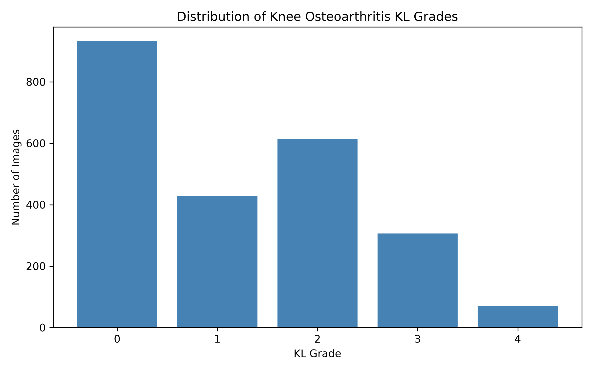
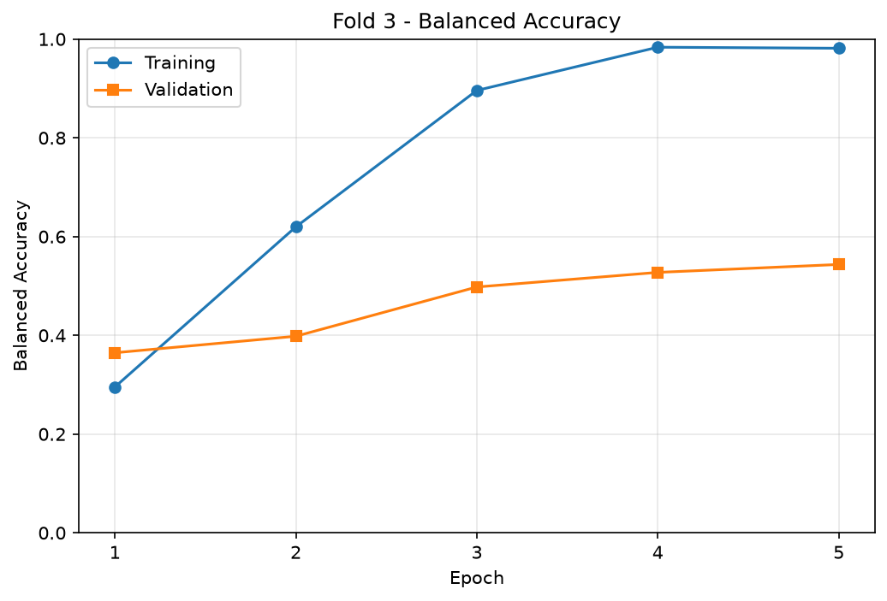
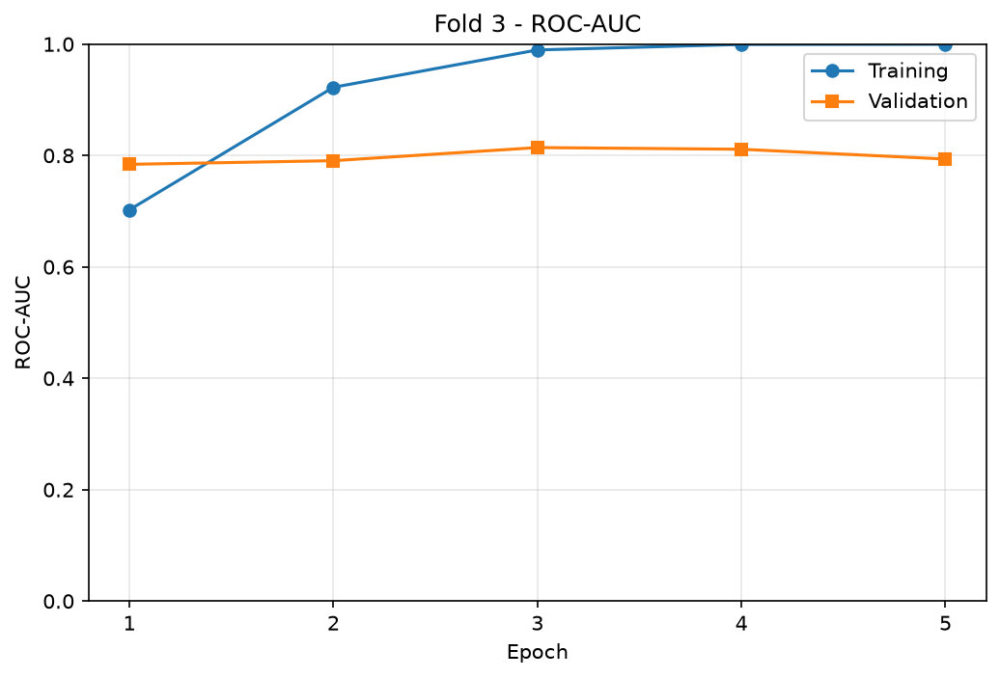
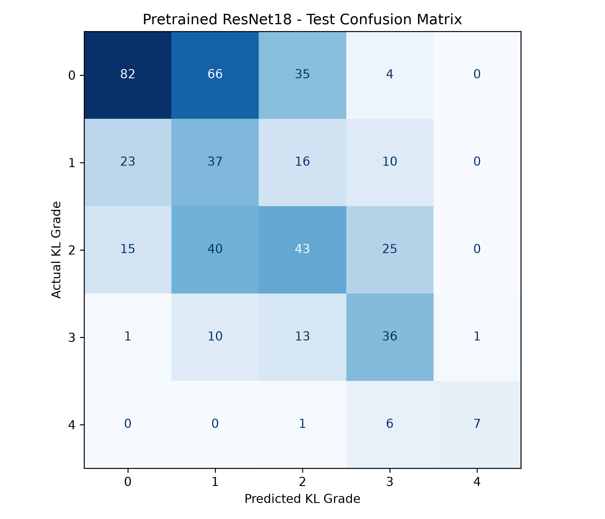

# Knee Osteoarthritis Severity Classification Using Deep Learning

## Project Overview

This project explores automated knee osteoarthritis severity classification from X-ray images using deep learning.

The objective is to classify knee X-ray images into five Kellgren–Lawrence (KL) grades, ranging from KL0 to KL4.

The project includes knee region-of-interest (ROI) extraction, dataset analysis, preprocessing, ResNet18 training, cross-validation, and model evaluation.

## Dataset

The classification dataset contains **2,352 grayscale knee X-ray images**.

| KL Grade | Number of Images |
|---|---:|
| KL0 | 932 |
| KL1 | 428 |
| KL2 | 615 |
| KL3 | 306 |
| KL4 | 71 |
| **Total** | **2,352** |

The dataset is imbalanced, with considerably fewer KL4 images.

## Methodology

1. Extract knee regions of interest from sample DICOM images using BoneFinder landmarks.
2. Analyze image distributions and preprocessing.
3. Split the classification dataset into development (80%) and held-out test (20%) sets using stratification.
4. Perform stratified 5-fold cross-validation on the development set.
5. Train a baseline ResNet18 model from scratch.
6. Train an ImageNet-pretrained ResNet18 model.
7. Compare models using balanced accuracy, ROC-AUC, and average precision.
8. Evaluate the selected pretrained model on the held-out test set.

## Model Results

| Metric | Baseline ResNet18 | Pretrained ResNet18 |
|---|---:|---:|
| Mean CV balanced accuracy | 21.21% | 51.15% |
| Mean CV ROC-AUC | 0.5837 | 0.7937 |
| Mean CV average precision | 0.2458 | 0.5530 |

The pretrained ResNet18 achieved substantially better cross-validation results than the model trained from scratch.


### Held-Out Test Results

The ImageNet-pretrained ResNet18 model selected from fold 3 was evaluated on a held-out test set of **471 knee X-ray images**.

| Metric | Result |
|---|---:|
| Accuracy | 43.52% |
| Balanced accuracy | 46.17% |
| ROC-AUC | 0.7646 |
| Average precision (AP) | 0.5109 |

### Precision and Recall Evaluation

Precision and recall were evaluated using micro, macro, and weighted averaging across all five Kellgren–Lawrence grades.

| Averaging Method | Precision | Recall |
|---|---:|---:|
| Micro | 43.52% | 43.52% |
| Macro | 52.74% | 46.17% |
| Weighted | 50.08% | 43.52% |

- **Micro averaging** aggregates predictions across all classes. In single-label multiclass classification, micro precision and recall are equal to overall accuracy.
- **Macro averaging** gives equal importance to every KL grade, making it useful for assessing performance across imbalanced classes.
- **Weighted averaging** weights each grade according to the number of actual test images in that class.

#### Precision and Recall by KL Grade

| KL Grade | Precision | Recall | Test Images |
|---|---:|---:|---:|
| KL0 | 67.77% | 43.85% | 187 |
| KL1 | 24.18% | 43.02% | 86 |
| KL2 | 39.81% | 34.96% | 123 |
| KL3 | 44.44% | 59.02% | 61 |
| KL4 | 87.50% | 50.00% | 14 |

#### Interpretation

- **KL0:** Relatively high precision (67.77%), but recall is only 43.85%.
- **KL1:** Lowest precision (24.18%), indicating many incorrect KL1 predictions.
- **KL2:** Lowest recall (34.96%), indicating difficulty identifying actual KL2 images.
- **KL3:** Highest recall (59.02%), but precision is 44.44%.
- **KL4:** Highest precision (87.50%), but recall is only 50.00%. The model correctly identified 7 of the 14 actual KL4 images.

These results demonstrate that model performance varies substantially across KL grades. The small number of KL4 test images also makes its precision and recall estimates less stable.

The detailed evaluation results are available in:

- `outputs/pretrained/test_results.csv`
- `outputs/pretrained/test_classification_report.csv`
- `outputs/pretrained/test_confusion_matrix.png`

The model is intended for educational research and is not validated for clinical diagnosis.


## Visualizations

### Dataset Distribution



### Pretrained Model — Fold 3 Training





### Test Confusion Matrix



Additional training plots and evaluation CSV files are available in the `outputs/baseline/` and `outputs/pretrained/` directories.

## Technologies Used

- Python
- PyTorch and Torchvision
- Scikit-learn
- Pandas and NumPy
- Matplotlib
- Pydicom
- Pillow
- PyCharm
- Git and GitHub

## Installation

Clone the repository:

```bash
git clone https://github.com/Yasubst/knee-osteoarthritis-classification.git
cd knee-osteoarthritis-classification
```

Create a Python virtual environment and install the dependencies:

```bash
python -m venv .venv
```

Activate the virtual environment on Windows PowerShell:

```powershell
.\.venv\Scripts\Activate.ps1
```

Install the requirements:

```bash
python -m pip install -r requirements.txt
```

The dataset and trained model checkpoints are not included in the repository.

## Limitations

- The dataset has a substantial class imbalance.
- Training results suggest overfitting.
- Patient-level independence between dataset splits has not yet been verified.
- The model is intended for educational research, not clinical diagnosis.

## Future Work

- Improve generalization and minority-class performance.
- Investigate patient-level data splitting.
- Explore additional model architectures.
- Implement tibia segmentation using U-Net.
- Compare classification and segmentation-based approaches.

## Project Status

**Knee osteoarthritis classification:** Completed initial experiments and evaluation.

**Tibia segmentation:** Planned.

This is an educational deep learning project developed as part of practical machine learning and medical image analysis studies.